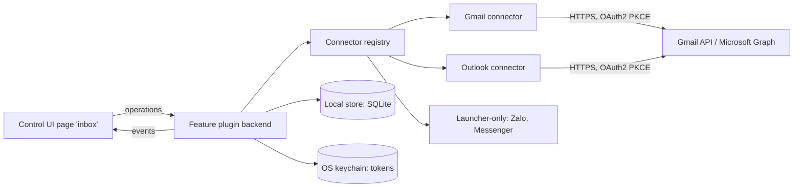

# OpenClaw Personal – System Design (HLD) và xác minh

Trạng thái: đề xuất, chưa triển khai. Hiện tại plugin chỉ là launcher (xem README). Tài liệu này thiết kế hướng nâng cấp lên hộp thư hợp nhất, giữ nguyên ràng buộc: chỉ dùng API chính thức, không lưu mật khẩu, không gửi tự động.

## 1. Mục tiêu và phi mục tiêu

Mục tiêu (pha 1–2):
- Đọc và trả lời email Gmail/Outlook qua OAuth chính thức, hiển thị trong một danh sách thống nhất.
- Số chưa đọc, thông báo, tìm kiếm cục bộ.
- Gửi chỉ khi người dùng bấm xác nhận.

Phi mục tiêu:
- Zalo cá nhân và Messenger cá nhân: không có API chính thức cho tài khoản cá nhân, giữ ở dạng launcher. Zalo OA và Facebook Page là sản phẩm khác, chỉ làm connector riêng khi có yêu cầu.
- Không nhúng iframe trang bên thứ ba, không scrape.

## 2. Kiến trúc tổng thể



Thành phần:
- **UI** (`src/control-ui.js`): danh sách hội thoại, khung đọc, soạn thảo, trạng thái từng tài khoản. Chỉ gọi operations, không giữ token.
- **Backend** (`src/index.js`): đăng ký operations/events qua feature contract; điều phối sync, gửi, thông báo.
- **Connector**: một interface chung, mỗi nhà cung cấp một module.
- **Store**: SQLite cục bộ lưu metadata và nội dung đã đồng bộ.
- **Vault**: refresh token lưu ở keychain hệ điều hành, không ghi file/DB.

## 3. Giao diện connector

```ts
interface Connector {
  id: 'gmail' | 'outlook';
  capabilities: { read: boolean; send: boolean; push: boolean };
  authorize(): Promise<AccountRef>;          // OAuth2 + PKCE, scope tối thiểu
  sync(account, cursor?): Promise<{ items: Message[]; cursor: string }>;
  send(account, draft): Promise<{ id: string }>; // chỉ gọi sau xác nhận UI
  revoke(account): Promise<void>;
}
```

Tài khoản chỉ launcher có `capabilities` toàn false và chỉ cung cấp link.

## 4. Mô hình dữ liệu

| Bảng | Cột chính |
|---|---|
| account | id, provider, address, status, cursor, last_sync_at |
| thread | id, account_id, remote_id, subject, last_message_at, unread_count |
| message | id, thread_id, remote_id, from, to, snippet, body_ref, received_at, is_read |
| draft | id, account_id, thread_id, body, created_at, confirmed_at |
| audit | id, ts, action (authorize/send/revoke), account_id |

Index: `thread(account_id, last_message_at DESC)`, `message(thread_id, received_at)`, unique `(account_id, remote_id)` để sync idempotent.

## 5. Luồng chính

**Kết nối tài khoản:** UI `account.connect` → backend mở trình duyệt hệ thống tới trang cấp quyền → redirect loopback nhận code (PKCE) → đổi token → lưu keychain → tạo bản ghi account.

**Đồng bộ:** định kỳ (mặc định 2 phút) và khi mở trang. Gmail dùng `history.list` theo `historyId`, Outlook dùng delta query. Upsert theo `(account_id, remote_id)`; lỗi 401 thì refresh token, lỗi 429 thì backoff mũ có jitter; phát event `inbox.updated`.

**Gửi:** UI tạo draft → hiển thị xem trước → người dùng bấm Gửi → backend kiểm `confirmed_at` → connector.send → ghi audit. Không có đường gửi nào bỏ qua bước xác nhận (kể cả tool/agent).

## 6. Operations và events (dự kiến)

Operations: `account.list`, `account.connect`, `account.disconnect`, `thread.list`, `thread.get`, `message.markRead`, `draft.save`, `draft.send`, `sync.now`.
Events: `inbox.updated`, `account.statusChanged`, `sync.failed`.
`contracts.tools` giữ rỗng cho đến khi có quyết định cho agent truy cập hộp thư.

## 7. Bảo mật và riêng tư

- Scope tối thiểu: Gmail `gmail.readonly` + `gmail.send` (cấp khi bật gửi); Graph `Mail.Read`, `Mail.Send`.
- Token chỉ ở keychain; ngắt kết nối thì revoke và xóa dữ liệu cục bộ của tài khoản.
- Render nội dung email: sanitize HTML, chặn ảnh từ xa mặc định, `textContent` cho các trường văn bản (chống XSS, vì plugin JS chạy với quyền operator UI).
- Không log nội dung thư; audit chỉ ghi hành động.
- Ứng dụng OAuth cần đăng ký và xác minh với Google/Microsoft (scope nhạy cảm có thể yêu cầu review).

## 8. Hiệu năng và mở rộng

- Sync gia tăng theo cursor: O(số thay đổi), không quét lại toàn hộp thư.
- Backfill giới hạn 30 ngày đầu, tải phần còn lại theo yêu cầu.
- Danh sách phân trang theo `last_message_at` (keyset), không dùng OFFSET.
- Thêm connector mới chỉ cần implement interface và đăng ký vào registry.

## 9. Lộ trình

1. Khung: registry, store, vault, operations rỗng, test contract.
2. Outlook hoặc Gmail chỉ đọc (một nhà cung cấp trước).
3. Nhà cung cấp còn lại, thông báo, tìm kiếm cục bộ.
4. Soạn/gửi có xác nhận.
5. Tùy chọn: Zalo OA / Facebook Page nếu có nhu cầu và chấp nhận phạm vi khác tài khoản cá nhân.

## 10. Rủi ro và câu hỏi mở

- Chưa xác minh API của OpenClaw SDK về lưu trữ/keychain và mở trình duyệt hệ thống; cần kiểm tra trước pha 1.
- Quy trình review OAuth của Google có thể kéo dài; cân nhắc chế độ "app test" cho dùng cá nhân.
- Cần quyết định: dữ liệu thư lưu cục bộ có mã hóa không (SQLCipher) hay chỉ dựa vào mã hóa đĩa.

## 11. Kết quả xác minh hiện tại

- Build completed and OpenClaw metadata validates for `openclaw-personal`.
- 3/3 tests passed: official HTTPS URLs, accessible truthful DOM and disposal, isolated page/navigation.
- No backend operations, credentials, account synchronization or automatic sends.
- Desktop rendering of the renamed package is not verified. Original local plugin remains installed separately.
- Zalo card (read-only): `channels.status` verified against the real Gateway (`openclaw channels status --json`): `zalouser` is enabled, configured, not linked; `statusIssues` also lists an auth issue for it, so `linked:false` is classified before errors. Signature `host.request(method, params)` verified in `feature-contract.js`. Scope for `channels.status` not individually proven (docs: read-only status needs `operator.read`).
- Email card (read-only): `email.status` query operation, no tool, no secrets copied from config; Outlook stays launcher-only.
- 19/19 tests pass, `tsc` clean, `openclaw plugins validate` valid. Rendering checked in headless Chrome against a fake host serving real status data, not in the real Control UI (plugin not installed there).
- Messenger card (read-only): `fb-messenger` is the third-party channel (Facebook Page/Instagram), status via `channels.status`. Real Gateway shows one `default` account, configured, not running, so the card shows 'Đã cấu hình, chưa chạy'. 27/27 tests pass in total.
